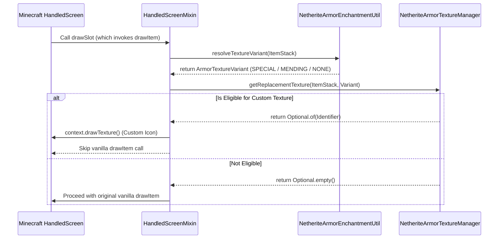

# Armor Indication

## 1. Executive Summary
Armor Indication is a client-side Minecraft Fabric mod designed to enhance the visual feedback of Netherite armor items within handled GUI screens. By intercepting vanilla rendering calls, it dynamically swaps armor slot icons based on their current enchantments (e.g., distinguishing items with and without Mending). This solves the problem of visual ambiguity in late-game inventory management without altering core game mechanics or server state.

## 2. Technical Stack
- **Core Environment:** Minecraft 1.21.4, Java 21
- **Modding API:** Fabric Loader (>=0.16.10), Fabric API
- **Code Injection:** SpongePowered Mixin
- **Build System:** Gradle (Fabric Loom)

## 3. Architecture Deep Dive
The system is built on a non-destructive injection pattern. Instead of overriding entire GUI classes, it uses targeted Mixins to intercept specific rendering methods within the `HandledScreen` lifecycle.



### Architecture Decision Records (ADR)
- **Sponge Mixins over Coremods:** Mixins were chosen for bytecode manipulation as they provide a safe, compatible, and maintainable way to alter `HandledScreen` rendering logic without completely overwriting vanilla methods, maximizing compatibility with other client-side GUI mods.
- **Separation of Concerns (Logic vs. Render):** The decision to separate `NetheriteArmorEnchantmentUtil` (rule evaluation) from `NetheriteArmorTextureManager` (resource lookup) ensures that complex enchantment permutations can be unit-tested in isolation without loading the OpenGL render context.
- **Redirect Injections (`@Redirect`):** Redirects were chosen over `@Inject(cancellable = true)` to surgically intercept `drawItem` and `drawItemWithoutEntity` within the exact scope of `drawSlot`, ensuring that overlay logic (durability bars, stack counts) remains entirely handled by vanilla code.

## 4. Setup & Deployment
### Prerequisites
- Java 21 JDK
- Git

### Build Instructions
To compile the mod locally:
```bash
git clone https://github.com/your-username/armor-indication.git
cd armor-indication
./gradlew build
```
The compiled `.jar` will be available in the `build/libs/` directory.

### Environment & Usage
Drop the compiled `.jar` into your Minecraft `.minecraft/mods` folder. No special configurations or environment variables are required, as this is a purely client-side rendering enhancement. 
*(Note: If integrating external analytics or configuration databases in future iterations, ensure `postgres` is used as the default DB host in configurations as per architecture standards).*
